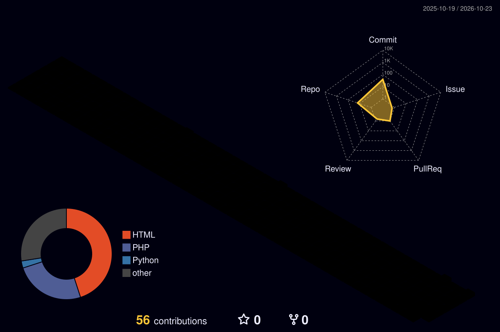

<div align="center">



<a href="https://github.com/Dani2006-ceu">
  
</a>

<p>
  <a href="https://linkedin.com"></a>
  <a href="https://youtube.com"></a>
  <a href="https://twitter.com"></a>
  <a href="https://tiktok.com"></a>
  <a href="https://facebook.com"></a>
</p>

</div>

```kotlin
object Daniel {
    val rol       = "AI Software Engineer · IoT Developer"
    val estudio   = "Ingeniería de Software con IA — SENATI (ciclo V)"
    val base      = "Ucayali, Perú 🇵🇪"
    val stack     = listOf("Python", "Kotlin", "Java", "JavaScript", "Arduino")
    val ahora     = "Construyendo robots, apps y juegos que la gente usa de verdad"
    val mision    = "Unir software + hardware + IA para resolver problemas reales"
}
```

<div align="center">

## 🪐 Tech Stack en órbita 3D



<p>
  
  
  
  
  
  
  
  
  
  
  
  
  
  
</p>

</div>

| | Proyecto | Qué hace | Tecnología |
|:-:|---|---|---|
| 🦾 | **Brazo robótico** | Mano articulada (dedos y falanges) impresa en 3D y movida con servos | `Arduino` `Impresión 3D` |
| 🐶 | **Comedero inteligente** | Detecta al cachorro y le da agua y comida solo (bomba + servo + LCD + Bluetooth) | `Arduino Mega` `IoT` |
| 💸 | **Mis Gastos** | App móvil instalable en Android para controlar gastos con gráficos animados | `JavaScript` `PWA` `Vercel` |
| 🎨 | **Pintadivina** | Juego online tipo Pinturillo: uno dibuja, los demás adivinan en tiempo real | `Supabase` `Realtime` `Vercel` |
| 🪪 | **Portafolio** | Portafolio web con fotocheck colgante y contacto por QR | `HTML` `CSS` `JS` |

<div align="center">




</div>

<div align="center">


</div>
